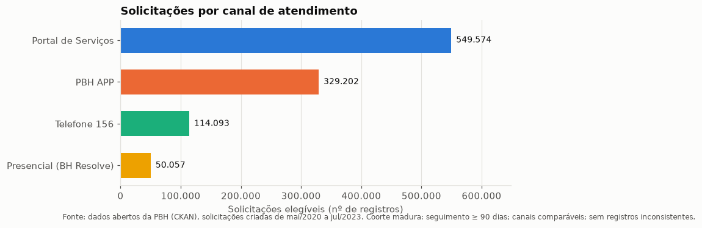
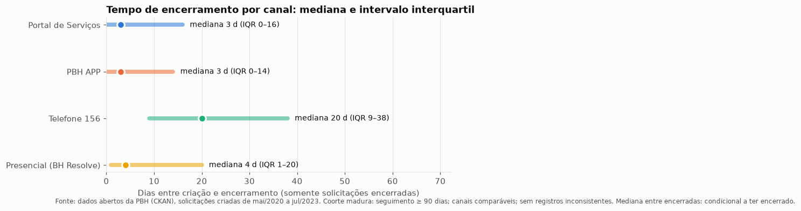
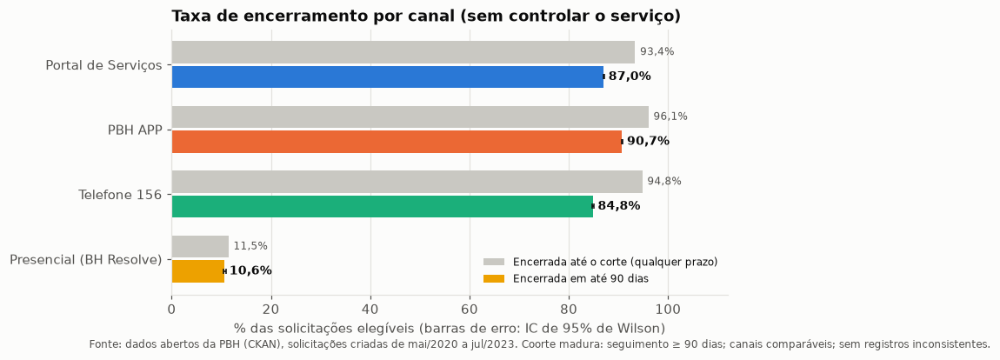
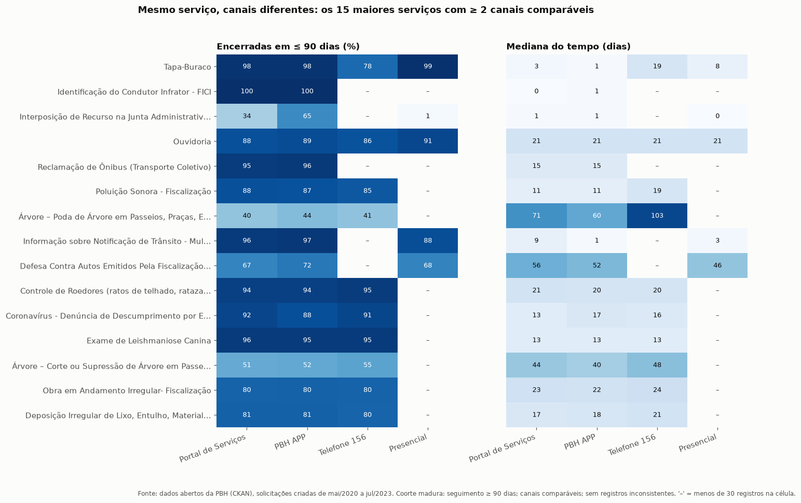
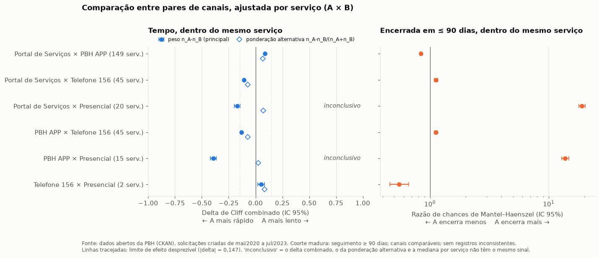
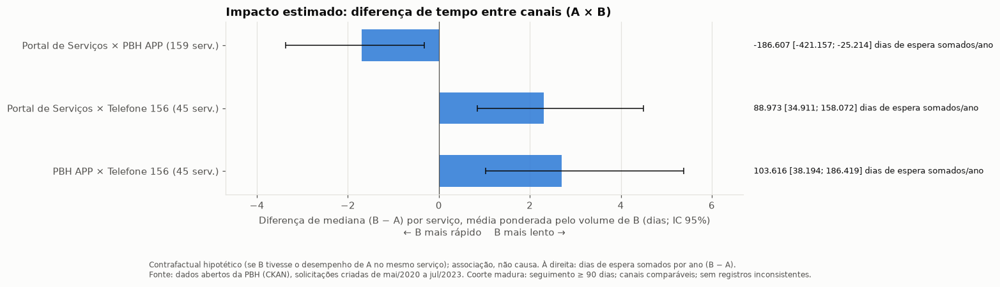

# Canais de atendimento da PBH: tempo e taxa de encerramento

**Autores:** Integrante A, Integrante B, Integrante C <!-- PREENCHER P14: nomes completos e papéis (a FONTE só tem os primeiros nomes, não confirmados) -->

**Disciplina:** Laboratório de Experimentação de Software, PUC Minas, 2026/2 · **Professor:** Danilo Maia

**Rascunho de 25/11/2026** · Repositório `Laboratorio-Medicao/Lab05` <!-- PREENCHER P14: link do repositório e do GitHub Projects -->

> **Estado deste texto.** Rascunho **sem revisão do trio**. A mudança de metodologia (de experimento com participantes para dados abertos de operação) e as decisões de desenho (coorte madura de 90 dias, mínimo de 30 por célula, estratificação por serviço) **ainda não foram aprovadas pelo professor** (P15 e P16, abertas).

<!-- fonte: interpretacao_resultados §1; conclusoes_limitacoes §1 -->
## Resumo

A Prefeitura de Belo Horizonte (PBH) atende o cidadão por quatro canais: Portal de Serviços, PBH APP, Telefone 156 e atendimento presencial (BH Resolve). Este estudo pergunta se, **para um mesmo serviço**, o tempo de encerramento e a proporção de solicitações encerradas diferem conforme o canal. É uma análise observacional retrospectiva dos dados abertos de operação da PBH (CKAN, licença CC-BY): 1.480.736 solicitações criadas de maio/2020 a julho/2023, das quais 1.042.926 entram na análise principal.

Sem controlar o serviço, os canais parecem muito diferentes. No mesmo serviço, o efeito típico é cerca de 10 vezes menor: a diferença vem sobretudo de **qual serviço** cada canal atende. Portal e PBH APP são parecidos, com leve vantagem do APP; o Telefone 156 é mais lento na maioria dos serviços em comum, de forma desprezível. O Presencial é **inconclusivo**: um serviço (recurso à JARI) domina a proporção e outro (Tapa-Buraco) define o sinal do tempo. Tudo é **associação, não causa**, e "encerrada" é encerramento administrativo, não prova de que o problema foi resolvido.

<!-- fonte: S01_criterios §1, §8; FONTE §4.1 -->
## 1. Introdução e objeto de estudo

O objeto é o **ecossistema de atendimento ao cidadão da PBH**: o Portal de Serviços (plataforma SYDLE ONE, parte da plataforma unificada BH Digital), o aplicativo PBH APP, a Central telefônica 156 e o atendimento presencial no BH Resolve. O estudo não usa código-fonte: observa o serviço pelas solicitações que a PBH publica como dados abertos.

O enunciado exige software real, em operação e de alto impacto, com números e fontes. A Tabela 1 resume as evidências, conferidas em 20/11/2026 (detalhes e capturas em `docs/evidencias/S01_criterios_do_software.md`).

**Tabela 1.** Os três critérios do enunciado.

| Critério | Evidência | Fonte e data |
|---|---|---|
| Real | O HTML do Portal carrega pacotes `@sydle/*`; o rodapé traz "Powered by SYDLE" | Portal, 20/11/2026 |
| Em operação | No ar desde 12/05/2020 (lançamento pela PBH); versão observada em 20/11/2026 identificada só por hashes de build dos pacotes `@sydle/*` (o Portal não publica número de versão nem data de release) | Notícia da PBH, 12/05/2020; Portal, 20/11/2026 |
| Alto impacto | 1.492 serviços catalogados, 1.118 solicitáveis pela internet; 92% das demandas de janeiro a setembro de 2026 pelo Portal ou aplicativo | PBH, 05/10/2026 |
| Alto impacto | 496.956 solicitações de janeiro a outubro de 2023, somando os quatro canais | PBH, 27/12/2023 |
| Alto impacto | 2.315.560 habitantes em Belo Horizonte | IBGE, Censo 2022 |

Duas ressalvas. Os números de volume são **autodeclarados pela PBH**, sem fonte independente, e os acessos mensais ao Portal são desconhecidos (o pedido via Lei de Acesso à Informação, P10, enviado em 22/11/2026, segue sem resposta registrada). Os números mudam com a data (18/08/2026: 1.489 serviços e 903 solicitáveis), por isso levam a data.

A pergunta: **para um mesmo serviço, existem diferenças no tempo de encerramento e na proporção de solicitações encerradas conforme o canal?**

<!-- fonte: metodologia §2, §3, §3.1 -->
## 2. Pergunta, caminho e planejamento

### 2.1 O caminho escolhido e por que mudou

O enunciado lista "analisar dados de operação" entre os caminhos. A proposta inicial (S01) previa um experimento com 32 participantes comparando celular e computador, com sessões presenciais, o que exigia recrutar e moderar dezenas de sessões: uma sobrecarga incompatível com o grupo. A nova abordagem usa **dados abertos reais de operação**, sem participantes; o objeto é o mesmo, e os critérios da Tabela 1 continuam válidos. **Não há registro de que o professor tenha aprovado a mudança** (P15).

### 2.2 Objetivo, perguntas e métricas (GQM)

No template de Basili: **analisar** as solicitações registradas no BH Digital, **com o propósito de** comparar, **com respeito ao** tempo e à taxa de encerramento, **do ponto de vista da** gestão do atendimento ao cidadão, **no contexto** dos dados abertos da PBH de maio/2020 a julho/2023.

**Tabela 2.** Perguntas do GQM e métricas.

| Pergunta | Métricas |
|---|---|
| Q1. Quais canais têm menor tempo mediano de encerramento? | Mediana, P25–P75 e P90 (dias); mediana de Kaplan–Meier |
| Q2. A proporção encerrada difere entre canais? | % encerrada em até 90 dias e até o corte |
| Q3. As diferenças permanecem dentro do mesmo serviço? | OR de Mantel–Haenszel, delta de Cliff combinado, I², serviços em cada sentido |
| Q4. Quais serviços diferem mais entre canais? | Maior \|delta\| e maior \|diferença de risco\| por serviço |

### 2.3 Variáveis e hipóteses

A **unidade de análise** é a solicitação, sem sujeitos humanos. O **fator** é o canal (quatro níveis). As **variáveis dependentes** são o tempo de encerramento em dias (razão, só das encerradas) e "encerrada em até 90 dias" (nominal binária). O **controle** é a estratificação por serviço. **Parâmetros fixos:** horizonte de 90 dias, mínimo por célula serviço × canal de 30 registros elegíveis para a proporção e 30 encerradas para o tempo, e α = 0,05 (decisões do grupo, P16 pendente). Ficam **sem controle** urgência e perfil do solicitante, região (descartada por privacidade), ano e mudanças de plataforma.

As H1 são bicaudais. **H-Q1 e H-Q2** (globais, sem ajuste): o tempo e a proporção encerrada em até 90 dias não diferem entre os quatro canais (Kruskal–Wallis; qui-quadrado r×2). **H-Q3p e H-Q3t** (por par A × B, entre serviços): OR de Mantel–Haenszel igual a 1 (CMH); tempos sem diferença estocástica dentro dos serviços (van Elteren); e, nos testes dos sinais, mesma chance de cada canal levar vantagem num serviço. **H-S e H-O** (por serviço): sem diferença entre canais na proporção (qui-quadrado ou Fisher no par; qui-quadrado r×2 com 3 canais ou mais) nem, em teste separado, no tempo (Mann–Whitney; Kruskal–Wallis para 3 canais ou mais).

Q1 é descritiva (H-Q1 é só o teste global, sem ajuste pelo serviço); Q4 é exploratória e não tem hipótese própria. **Regra de decisão:** rejeitar H0 com p abaixo de 0,05 (corrigido por Holm quando o teste pertence a uma família) **e** só chamar a diferença de relevante se a magnitude for pelo menos "pequena". As definições e os testes foram fixados antes dos resultados, mas as hipóteses só foram escritas em 25/11/2026, **depois** deles: não são pré-registradas (C6, Seção 8).

**Design:** observacional retrospectivo, estratificado por serviço, sem atribuição de tratamento; **instrumentação:** `scripts/pipeline.py` e seus testes (Seção 3); **operação:** coleta única pela API do CKAN a 1 req/s.

<!-- fonte: dicionario §1–§6; metodologia §5; verificacao_pipeline -->
## 3. Dados e instrumentação

**Fonte.** O conjunto "Solicitações dos cidadãos, por meio dos canais de atendimento da PBH", no CKAN da PBH (licença CC-BY, SUMOG), tem 10 CSVs e um dicionário em PDF (de 25/07/2023). A **cobertura real é de maio/2020 a julho/2023**: não há 2024 a 2026, o que a proposta inicial supunha e a fonte desmentiu (divergência D11 da FONTE_DA_VERDADE).

**Ética e privacidade.** O acesso usa a API do CKAN, com user-agent identificado e **1 requisição por segundo**, como o enunciado exige; o Portal não é acessado de forma automatizada. As colunas de endereço e localização (logradouro, número, bairro, regional, coordenadas) são **descartadas na leitura**, por lista branca, e nunca chegam à memória nem ao disco; o Id é pseudonimizado; os CSVs brutos ficam fora do repositório. Testes automatizados (74 passando) cobrem essas garantias.

**Tratamento.** O pipeline (`python scripts/pipeline.py`) converte os dois formatos de data, normaliza os canais, remove duplicatas, classifica cada registro (**encerrada**, **aberta** ou **inconsistente**), calcula o tempo e gera tabelas e gráficos. **Aberta nunca recebe tempo 0**; os inconsistentes são excluídos e contados. A base tem 460 serviços distintos. A análise principal usa só canais comparáveis e seguimento de pelo menos 90 dias até o corte de observação (a coorte madura, para as recentes não parecerem "abertas" por falta de tempo). O corte é um proxy: a PBH não publica a data de extração, e usa-se a maior data de encerramento de cada arquivo.

**Tabela 3.** Funil de elegibilidade (`funil_elegibilidade.csv`).

| Etapa | Registros |
|---|---:|
| Registros na base analítica (sem duplicatas) | 1.480.736 |
| Excluídos: inconsistentes | 7 |
| Excluídos: canal não comparável (integração, origem interna, e-mail) | 298.570 |
| Excluídos: seguimento < 90 dias (coorte imatura) | 139.233 |
| **Elegíveis (análise principal)** | **1.042.926** |

**Limitações da fonte.** O significado dos canais "Integração entre Sistemas" e "Origem Interna" e da coluna de situação não é documentado pela PBH, e por isso não os interpretamos nem classificamos o encerramento em "resolvido" ou "negado". Faltam também identificador do cidadão e resolução além do dia.

**Reprodutibilidade.** Em 25/11/2026 o pipeline foi reexecutado do zero, com download real, por um **agente de IA (Claude Sonnet) a pedido de um integrante, e não por um integrante**. Os 10 CSVs e a base saíram com os mesmos SHA-256 e as tabelas ficaram idênticas; só houve diferenças de forma (por exemplo, a última casa decimal de 41 números de `resultados.json`). Veredito: "reproduzido com ressalvas"; duas falhas de portabilidade foram corrigidas sem mudar parâmetros nem resultados.

<!-- fonte: metodologia §7 -->
## 4. Classificação da pesquisa

O laboratório se chama "Experimento Final", mas o estudo **não é um experimento**: o canal não foi atribuído aleatoriamente nem pelo pesquisador. O enunciado aceita estudo observacional e exige **classificar corretamente** e discutir a força da evidência. A Tabela 4 traz as sete categorias, revisadas com base no que foi executado (S03).

**Tabela 4.** Classificação em sete categorias.

| Categoria | Classificação | Justificativa |
|---|---|---|
| Natureza | Aplicada | Gestão de um serviço público em produção |
| Objetivos | Descritiva e exploratória-comparativa | Q1 e Q4 descrevem; Q2 e Q3 comparam, mas só medem associação, sem mecanismo causal |
| Abordagem | Quantitativa | Todas as medidas são numéricas |
| Procedimentos | Pesquisa documental com dados secundários de operação; observacional retrospectivo (*ex post facto*) | Dados abertos já existentes; sem intervenção do pesquisador |
| Tempo | Retrospectivo: coorte retrospectiva por solicitação, com análise agregada no período, sem tendência temporal | Seguimento até o encerramento ou o corte; três anos analisados juntos |
| Controle | Sem controle experimental; controle estatístico por estratificação por serviço | O canal é autosselecionado; urgência e perfil não estão nos dados |
| Nível de evidência | Observacional: associação, não causa | O efeito global some em grande parte ao controlar o serviço (Seção 6.2) |

A revisão **corrigiu uma classificação preliminar**: "longitudinal retrospectivo" sugeria estudo de evolução no tempo, mas os três anos são analisados juntos.

<!-- fonte: metodologia §4, §6 -->
## 5. Métricas e análise

### 5.1 Métricas e escalas

**Tabela 5.** Métricas, escalas e estatística adequada.

| Métrica | Escala | Estatística adequada |
|---|---|---|
| Tempo de encerramento: dias entre criação e encerramento, só de encerradas | Razão | Mediana, quartis, testes de postos |
| Encerrada em até 90 dias | Nominal (binária) | Proporção, qui-quadrado ou Fisher, CMH |
| Taxa de encerramento até o corte | Razão (%) | Descritiva |
| Solicitações por canal | Razão (contagem) | Descritiva |

A escala de razão admite média, mas a distribuição é muito assimétrica (no Portal, média de 23,1 dias contra mediana de 3) e tem muitos empates em 0; por isso a análise usa mediana, quartis e testes de postos. O tempo de encerramento é uma **métrica de processo**, análoga ao lead time e ao MTTR de operações de software. Como só as encerradas têm tempo, a mediana é **condicional a ter encerrado** e sempre vem junto da proporção encerrada; a de Kaplan–Meier (abertas como censuradas) serve de conferência.

### 5.2 Testes e tamanhos de efeito

- **Proporções:** qui-quadrado sem correção; Fisher exato em tabela 2×2 com esperado abaixo de 5. **Tempos:** Mann–Whitney assintótico e Kruskal–Wallis (3 canais ou mais); com tantos empates (encerramento no mesmo dia), a leitura é de **dominância estocástica** (delta de Cliff), não de diferença de medianas.
- **Entre serviços:** Cochran–Mantel–Haenszel (OR combinado, heterogeneidade por Q de Cochran e I²), van Elteren para tempos e teste dos sinais sobre o sentido em cada serviço. Um serviço só entra num par se as duas células atingem o mínimo (30 elegíveis para a proporção, 30 encerradas para o tempo).
- **Tamanhos de efeito:** diferença de risco, razão de chances, h de Cohen, delta de Cliff, ε² e V de Cramér. Magnitude do delta: desprezível abaixo de 0,147, pequena abaixo de 0,33, média abaixo de 0,474 (Romano et al., 2006); para o h, 0,2, 0,5 e 0,8 (Cohen). **Múltiplas comparações:** Holm dentro de cada família de testes.
- **Sinal:** para o par (A, B), delta > 0 significa A mais lento, e OR > 1 significa A encerra mais.

Com n da ordem de 10⁵ a 10⁶, quase todo p sai minúsculo: **a leitura é pelo tamanho do efeito e pela consistência entre serviços**, não pelo p.

### 5.3 Sensibilidade

Três verificações testam se a conclusão depende do desenho: os horizontes de 30 e 180 dias, além de 90; a mediana de Kaplan–Meier; e o delta de Cliff combinado com peso alternativo, n_A·n_B/(n_A+n_B), e com a mediana por serviço. A terceira foi acrescentada em 25/11/2026, **depois de ver os resultados** (divergência D14 registrada na FONTE_DA_VERDADE §18, issue #39), quando um serviço se mostrou dominante; a análise principal não mudou. Regra: quando os sinais do tempo de um par discordam, o par é **inconclusivo**.

<!-- fonte: interpretacao_resultados §1–§6; resumo.md; tabelas/*.csv -->
## 6. Resultados

Tudo aqui é **associação, não causa**; "encerrada" é encerramento administrativo.

### 6.1 Visão por canal, sem ajustar pelo serviço (Q1 e Q2)

**Tabela 6.** Métricas por canal na população elegível (`metricas_por_canal.csv`).

| Canal | Solicitações | Encerrada até o corte | Encerrada em ≤ 90 d | Mediana (d) | P25–P75 | P90 | Mesmo dia |
|---|---:|---:|---:|---:|---|---:|---:|
| Portal de Serviços | 549.574 | 93,4% | 87,0% | 3 | 0–16 | 57 | 28,7% |
| PBH APP | 329.202 | 96,1% | 90,7% | 3 | 0–14 | 45 | 27,1% |
| Telefone 156 | 114.093 | 94,8% | 84,8% | 20 | 9–38 | 95 | 3,5% |
| Presencial (BH Resolve) | 50.057 | 11,5% | 10,6% | 4 | 1–20 | 55 | 22,3% |

O Portal responde pela maior parte do volume e o Presencial pela menor (Figura 1).



**Figura 1.** Solicitações elegíveis por canal (`01_solicitacoes_por_canal.png`).

**Tempo (Q1; Figura 2).** Portal e PBH APP têm a mesma mediana, de 3 dias. O Telefone 156 tem 20 dias (21 por Kaplan–Meier), quase 7 vezes mais, e quase nunca encerra no mesmo dia. A mediana do Presencial (4 dias) vem só das que encerraram; menos da metade encerrou, e a mediana de Kaplan–Meier não existe: não é comparável.



**Figura 2.** Mediana e intervalo interquartil do tempo, só das encerradas (`03_tempo_mediano_por_canal.png`).

**Proporção (Q2; Figura 3).** Portal, PBH APP e Telefone 156 encerram de 84,8% a 90,7% em até 90 dias. O Presencial parece destoar, com 10,6%, mas **isso é efeito de um serviço**: das 50.057 solicitações presenciais elegíveis, 44.391 (88,7%) são recursos à JARI, que permanecem "em andamento" no sistema (1,2% encerradas).



**Figura 3.** Taxa de encerramento por canal, sem controlar o serviço (`02_taxa_encerramento_por_canal.png`).

Os testes globais rejeitam H-Q1 e H-Q2 (V de Cramér de 0,46; ε² de 0,077; não há limiar de magnitude fixado para essas medidas), mas **misturam serviços**.

### 6.2 O mesmo serviço (Q3)

**Quanto some ao controlar o serviço.** Entre os 58 serviços com 3 canais ou mais, a mediana do V de Cramér é 0,040 (contra 0,46 global; 12 serviços com p de Holm abaixo de 0,05) e a do ε² é 0,006 (contra 0,077; 24 serviços abaixo de 0,05). O efeito típico dentro do serviço é **cerca de 10 vezes menor** que o global: **confusão pelo tipo de serviço**, pois cada canal recebe uma mistura diferente de demandas (Figura 4).



**Figura 4.** Os 15 maiores serviços com pelo menos 2 canais comparáveis (`05_servico_x_canal.png`); o traço marca célula com menos de 30 registros.

**Proporção, por par.** A Tabela 7 traz o OR de Mantel–Haenszel, a mediana da diferença de risco entre serviços e em quantos serviços cada canal leva vantagem (p dos sinais, com Holm).

**Tabela 7.** Pares ajustados por serviço: proporção encerrada em até 90 dias.

| Par (A × B) | Serviços | OR de MH | Dif. de risco mediana | Serviços A / B encerra mais (p) |
|---|---:|---:|---:|---|
| Portal × PBH APP | 159 | 0,84 | −0,59 pp | 52 / 94 (0,004) |
| Portal × Telefone 156 | 45 | 1,12 | +0,32 pp | 25 / 20 (1,0) |
| PBH APP × Telefone 156 | 45 | 1,12 | +0,78 pp | 28 / 17 (0,68) |
| Portal × Presencial (**inconclusivo**) | 20 | 19,1 | −0,28 pp | 6 / 12 (0,71) |
| PBH APP × Presencial (**inconclusivo**) | 15 | 13,8 | +0,10 pp | 9 / 3 (0,68) |
| Telefone 156 × Presencial (2 serviços: não interpretar) | 2 | 0,55 | −12,8 pp | 0 / 2 (1,0) |

Só Portal × APP tem sentido consistente (o APP encerra um pouco mais). Nos pares com Presencial o OR (de 14 a 19) não descreve o canal: a heterogeneidade é quase total (I² de 0,99), o OR é dominado pela JARI e a mediana da diferença de risco fica perto de zero. **Não se pode dizer que o Presencial encerra menos quando o serviço é o mesmo.**

**Tempo, por par.** A Tabela 8 e a Figura 5 trazem o delta de Cliff combinado (peso n_A·n_B), o delta com o peso alternativo, a mediana dos deltas por serviço, em quantos serviços cada canal é mais lento e o serviço de maior peso.

**Tabela 8.** Pares ajustados por serviço: tempo de encerramento, só encerradas (delta > 0: A mais lento).

| Par (A × B) | Delta combinado (magnitude) | Peso alternativo | Mediana por serviço | Serviços A / B mais lento (p) | Maior peso (fatia) |
|---|---|---:|---:|---|---|
| Portal × PBH APP | +0,088 (desprezível) | +0,070 | +0,048 | 98 / 51 (0,0007) | Tapa-Buraco (59%) |
| Portal × Telefone 156 | −0,108 (desprezível) | −0,071 | −0,057 | 11 / 34 (0,003) | Ouvidoria (57%) |
| PBH APP × Telefone 156 | −0,130 (desprezível) | −0,074 | −0,065 | 8 / 37 (0,0001) | Ouvidoria (35%) |
| Portal × Presencial (**inconclusivo**, D14) | **−0,171** (pequena) | **+0,074** | **+0,103** | 17 / 3 (0,008) | Tapa-Buraco (44%) |
| PBH APP × Presencial (**inconclusivo**, D14) | **−0,391** (média) | **+0,027** | **+0,032** | 10 / 5 (0,60) | Tapa-Buraco (68%) |
| Telefone 156 × Presencial (2 serviços: não interpretar) | +0,052 (desprezível) | +0,084 | +0,213 | 2 / 0 (0,60) | Ouvidoria (100%) |



**Figura 5.** Delta de Cliff combinado (peso principal e alternativo) e OR de Mantel–Haenszel por par (`06_comparacao_pares_ajustada.png`). Nos pares marcados "inconclusivo", o delta combinado não é resultado (D14, explicada abaixo).

**O achado que muda a leitura (D14).** Com o peso n_A·n_B, um serviço com muitos registros num canal domina o delta combinado. Nos pares com Presencial isso é decisivo: no Tapa-Buraco, o Presencial tem só 217 encerradas contra 94.968 do Portal e 133.634 do APP, e é bem mais lento (mediana de 8 dias contra 3 e 1). Esse serviço responde por toda a vantagem dos canais digitais no delta combinado. Com o peso alternativo ou pela mediana por serviço, o sinal **se inverte**, e a contagem de serviços concorda (o Portal é mais lento em 17 de 20). O **tempo do Presencial frente aos canais digitais é inconclusivo**; nos três pares sem Presencial o sinal é o mesmo com qualquer ponderação.

**Decisão sobre as hipóteses (regra da Seção 2.3).** H-Q1 e H-Q2 são rejeitadas (p < 0,0001), mas o teste mistura serviços. H-Q3p (CMH) e H-Q3t (van Elteren) são rejeitadas nos seis pares (p de Holm < 0,05), mas nenhuma diferença é relevante pela regra: nos três pares sem Presencial o delta é desprezível e a mediana da diferença de risco por serviço fica abaixo de 1 ponto percentual; nos pares com Presencial a magnitude é inconclusiva (D14), e 156 × Presencial não se interpreta. Os testes dos sinais rejeitam H0 no tempo em Portal × APP, Portal × 156, APP × 156 e Portal × Presencial, e na proporção só em Portal × APP. Por serviço (H-S e H-O), rejeitam-se 30 e 59 de 286 comparações e 12 e 24 de 58 serviços (proporção e tempo).

**O que se pode dizer.** (1) O **Telefone 156** é mais lento em cerca de 3 de cada 4 serviços em comum, de forma consistente, mas com magnitude desprezível (delta mediano por serviço de −0,06). A distância de 3 contra 20 dias nas medianas gerais vem sobretudo de o 156 atender **outro conjunto de serviços** (68, contra mais de 360 nos digitais), em geral de fiscalização e manutenção urbana. (2) **Portal × PBH APP** é o resultado mais robusto: o APP encerra mais em 94 de 159 serviços em comum e é mais rápido em 98 de 149, com o mesmo sentido nas duas medidas, com qualquer ponderação e, na proporção, nos três horizontes; mas a diferença é **desprezível** para o cidadão médio. (3) Os pares com **Presencial** não sustentam conclusão.

### 6.3 Onde a diferença entre canais é grande (Q4)

Os rankings por serviço (`ranking_servicos_tempo.csv`, `ranking_servicos_proporcao.csv`) mostram diferenças grandes, mas concentradas em poucos serviços. No **tempo**: Tapa-Buraco (mediana de 1 dia no APP contra 19 no 156; delta de −0,72) e Informação sobre Notificação de Trânsito: Multa (9 dias no Portal contra 1 no APP; +0,52). Na **proporção em até 90 dias**: Iluminação Pública, luminária apagada à noite (APP 75,3% contra 36,2% do 156; 39,1 pp). O recurso à JARI (APP 65,0% contra 1,2% do Presencial; 63,8 pp) também é grande, mas domina os pares com Presencial.

As diferenças não seguem sempre o mesmo canal. Isso combina com a ideia de que o **fluxo interno do serviço** (roteamento e triagem) pesa mais que o canal de entrada, mas é uma **hipótese**, não algo que os dados mostram.

### 6.4 Sensibilidade ao horizonte

O OR de Mantel–Haenszel em 30, 90 e 180 dias (`sensibilidade_horizonte.csv`) mantém o **sentido** de todos os pares, então os 90 dias não mudam a conclusão sobre a proporção (Portal × APP: 0,84, 0,84 e 0,77). Nos pares com Presencial o OR varia muito (de 12,0 a 24,5 e de 7,6 a 23,2): estimativa **instável**, dominada pela JARI.

<!-- fonte: impacto §1–§7; impacto_por_par.csv -->
## 7. Impacto para quem usa

A pergunta é: **quanto tempo de espera, por ano, está associado à diferença de desempenho entre canais no mesmo serviço?** Nos pares com conclusão sustentada, a diferença **por pedido** é de poucos dias na mediana, e os totais anuais só parecem grandes por multiplicarem essa diferença por centenas de milhares de pedidos por ano. São **escala de grandeza**, não uma economia que alguém vá obter.

**Método.** É um **contrafactual hipotético**: "se os pedidos do canal B tivessem o desempenho do canal A no mesmo serviço". Em cada serviço com célula válida nos dois canais, a diferença de mediana (B − A) é ponderada pelo volume anual de B: as solicitações elegíveis do canal B naquele serviço divididas pela duração da coorte, de 11/05/2020 a 26/04/2023 (2,96 anos). Isso trata cada ano como igual, o que não vale. O IC de 95% vem de bootstrap de **serviços**. Só entram Portal × PBH APP, Portal × Telefone 156 e PBH APP × Telefone 156: **os pares com Presencial ficam de fora**, por inconclusivos, e não se usam medianas globais, que misturam serviços.

**Tabela 9.** Impacto por par (A × B; calculado sobre os pedidos de B), de `impacto_por_par.csv`.

| Par (A × B) | Serviços | Pedidos de B por ano | Dif. de mediana ponderada (dias) | Dias de espera por ano (B − A) | Encerradas em ≤ 90 d a mais por ano |
|---|---:|---:|---:|---:|---:|
| Portal × PBH APP | 159 | 110.551 | −1,69 [−3,37; −0,32] | −186.607 [−421.157; −25.214] | −760 [−1.647; −8] |
| Portal × Telefone 156 | 45 | 38.470 | +2,31 [0,84; 4,50] | +88.973 [34.911; 158.072] | +348 [18; 735] |
| PBH APP × Telefone 156 | 45 | 38.470 | +2,69 [1,02; 5,38] | +103.616 [38.194; 186.419] | +336 [−154; 829] |



**Figura 6.** Diferença de mediana (B − A) por serviço, ponderada pelo volume de B, com IC de 95% (`07_impacto_por_par.png`). Contrafactual hipotético; associação, não causa.

**Como ler o sinal.** No **tempo**, positivo significa B mais lento que A no mesmo serviço; na **taxa**, positivo significa que B encerra menos em até 90 dias. Em Portal × PBH APP (Figura 6), B é o APP: tempo e taxa são negativos, com IC que exclui zero, o que quer dizer que o APP encerra antes e encerra mais, no mesmo serviço, **não** que há "impacto negativo". Nos pares com o 156, B é o 156, mais lento no mesmo serviço (cerca de 2 a 3 dias na mediana ponderada); a taxa é menor nos dois, mas só no par com o Portal o IC exclui zero, e **em APP × 156 não se afirma diferença na taxa**, só no tempo.

**Limites do número.** O resultado é puxado por poucos serviços grandes: em Portal × PBH APP, o Tapa-Buraco responde por −90.314 dos −186.607 dias por ano (48%). O IC **não** cobre a confusão por perfil do pedido, a escolha do canal pelo cidadão, a variação entre anos nem o erro amostral das medianas. "Dias de espera por ano" soma diferenças de **medianas** entre serviços: serve para ordem de grandeza e para comparar pares, não como contagem de dias vividos. O estudo não estima 2024–2026. Os números públicos da Tabela 1 (496.956 solicitações em jan–out/2023; 2.315.560 habitantes) dão escala, mas não entram no cálculo: são autodeclarados e de outra data.

**Sem conversão em horas (P5).** Não se converteu o impacto em horas do cidadão, de propósito: a medida é o tempo até o encerramento administrativo, não o esforço do cidadão, e qualquer fator de conversão seria inventado. A P5 segue **aberta**.

<!-- fonte: metodologia §8 -->
## 8. Ameaças à validade

Revistas em 25/11/2026 (C = conclusão, I = interna, K = construto, E = externa). **Nenhuma ameaça é tratada como resolvida**: "O que resta" é o que continua em aberto depois da mitigação. A tabela completa, com evidência, está em `docs/metodologia.md` §8.

**Tabela 10.** Ameaças à validade, em resumo.

| ID | Tipo | Ameaça | Mitigação | O que resta |
|---|---|---|---|---|
| C1 | Conclusão | Com n da ordem de 10⁶, tudo sai "significativo" | Leitura pelo tamanho do efeito e pela contagem de serviços | O p quase não discrimina |
| C2 | Conclusão | Um serviço domina o efeito combinado com Presencial (Tapa-Buraco no tempo, JARI no OR) | Pares com Presencial tratados como inconclusivos; sensibilidade de ponderação (D14) | O OR não tem sensibilidade equivalente; sem conclusão com Presencial |
| C3 | Conclusão | Heterogeneidade alta entre serviços (I² de 0,89 a 0,99) | Mediana por serviço e teste dos sinais junto de todo valor combinado | O valor combinado não representa serviço algum |
| C4 | Conclusão | Independência não verificável (sem id do cidadão) | Declarada; não há procedimento possível | ICs e p podem estar otimistas |
| C5 | Conclusão | Muitos empates nos tempos | Mann–Whitney assintótico e delta de Cliff | Teste e IC menos precisos nos serviços rápidos |
| C6 | Conclusão | Hipóteses escritas depois dos resultados | Testes, horizonte e peso fixados antes; regra com magnitude mínima | Rigor menor que o pré-registrado |
| C7 | Conclusão | Holm vale dentro de cada família, não entre famílias | Conclusões por magnitude e consistência, não por p isolado | Falso positivo cresce com o total de testes |
| I1 | Interna | Confusão pelo tipo de serviço | Estratificação por serviço | Perfis dentro do serviço não são corrigidos |
| I2 | Interna | Autosseleção do canal; confusão residual (urgência, perfil, região) | Estratificação; linguagem de associação | Fatores ausentes ou descartados por privacidade |
| I3 | Interna | Censura à direita: pedidos recentes ainda abertos | Coorte madura de 90 dias; 30 e 180 dias; Kaplan–Meier | A coorte imatura fica fora; o corte é inferido (K3) |
| I4 | Interna | Mudanças de plataforma, regras e demanda (inclusive a pandemia) em 2020–2023 | Nenhuma (declarada) | O ano não é estratificador |
| K1 | Construto | "Encerrada" é encerramento administrativo, não resolução | O texto diz "encerrada", nunca "resolvida" | Um canal que encerra antes pode só fechar o pedido mais cedo |
| K2 | Construto | Situações e canais "Integração entre Sistemas" e "Origem Interna" sem documentação | Situações não interpretadas; canais fora (E4) | A situação não distingue resolução de negativa |
| K3 | Construto | O corte de observação é um proxy (maior data de encerramento por arquivo) | Declarado; usado só para a coorte | Se o corte real for outro, a coorte madura muda |
| K4 | Construto | Resolução de 1 dia: "0 dia" é o mesmo dia civil | Declarado; delta de Cliff (C5) | Medida grosseira para serviços rápidos |
| K5 | Construto | Normalização do nome do serviço e "?" da fonte podem juntar ou separar serviços | Chave normalizada (sem acento nem pontuação, em minúsculas) | Variantes de nome não verificadas |
| E1 | Externa | Só Belo Horizonte, mai/2020 a jul/2023 (inclui a pandemia) | Sem extrapolação | Não vale para outras cidades nem depois de jul/2023 |
| E2 | Externa | Só 164 dos 422 serviços com solicitações elegíveis têm pelo menos 2 canais com 30 registros ou mais | Comparação só onde há dado | Ficam fora 258 serviços, que somam 4,2% das elegíveis |
| E3 | Externa | Poucos serviços comuns com o Presencial (20 e 15) e só 2 em 156 × Presencial | 156 × Presencial marcado como "não interpretar" | Conclusões sobre o Presencial não generalizam |
| E4 | Externa | Canais "Integração entre Sistemas", "Origem Interna" e "E-mail" fora: 298.570 registros (20,2% da base) | Declarado | O resultado não vale para eles |

As mais sérias são **I1**, **C2**, **K1** e **E1**.

<!-- fonte: conclusoes_limitacoes §1–§5; interpretacao_resultados §8 -->
## 9. Conclusões, limitações e o que não é possível afirmar

### 9.1 O que o estudo mostrou

1. **A maior parte da diferença entre canais vem do serviço, não do canal** (pergunta principal e Q3): o efeito típico dentro de um serviço é cerca de 10 vezes menor que o global.
2. **Tempo (Q1) e proporção (Q2):** a distância de 3 contra 20 dias entre os digitais e o 156 encolhe no mesmo serviço: o 156 segue mais lento em cerca de 3 de cada 4 serviços, com magnitude desprezível, e não há vencedor consistente na proporção. Portal × APP é o resultado mais robusto: pequena vantagem do APP, desprezível.
3. **O Presencial não pode ser descrito pelos números agregados** (JARI na proporção, Tapa-Buraco no tempo): o resultado é **inconclusivo**.
4. **Há diferenças grandes, mas em poucos serviços** (Q4), e o horizonte de 90 dias não muda o sentido do OR de Mantel–Haenszel em nenhum par (30 e 180 dias).

### 9.2 O que isso significa para quem usa

**Para o cidadão.** No mesmo serviço, escolher entre Portal e APP faz pouca diferença, e o 156 tende a ser um pouco mais lento. Isso **não promete que trocar de canal acelere o atendimento**, nem que o pedido foi resolvido.

**Para a gestão da PBH.** A diferença global está em **qual serviço** cada canal atende, não no canal de entrada. Os serviços da Seção 6.3 são os candidatos a investigar primeiro.

### 9.3 Limitações

As limitações são as ameaças da Seção 8, com o que resta de cada uma. As que mais pesam: confusão e autosseleção (I1, I2); encerrada não é resolvida (K1, K2); Presencial sem conclusão (C2, E3); hipóteses escritas depois dos resultados (C6); e validade externa restrita a BH, mai/2020 a jul/2023 e serviços com pelo menos 2 canais comparáveis (E1, E2, E4).

### 9.4 O que não é possível afirmar

- Que mudar de canal acelera o atendimento (o estudo é observacional e o cidadão escolhe o canal).
- Que o Presencial encerra menos ou é mais lento para o mesmo serviço.
- Que encerrado significa resolvido.
- Que os "dias de espera por ano" (Seção 7) sejam economia de tempo.
- Qualquer coisa fora de BH, de mai/2020 a jul/2023 e dos serviços com pelo menos 2 canais comparáveis.

### 9.5 Trabalhos futuros

Perguntar à PBH se há dados após jul/2023 e qual é a regra da situação (P17); combinar com um survey de usuários; incluir o ano na análise; e testar o OR de Mantel–Haenszel sem o serviço Recurso à JARI.

<!-- fonte: FONTE §5, §12; metodologia §3–§8 -->
## 10. Conceitos da disciplina aplicados

A Tabela 11 mostra onde cada conceito foi aplicado.

**Tabela 11.** Conceitos da disciplina e onde aparecem.

| Conceito | Como foi aplicado | Onde |
|---|---|---|
| Goodhart, Campbell e McNamara | **Goodhart/Campbell:** se a taxa de encerramento virasse meta, poderia ser "jogada" (encerrar sem resolver). **McNamara:** medir só o que é fácil (a data de encerramento) e ignorar o que importa ao cidadão (resolução, satisfação). Por isso o texto nunca diz "resolvida" (K1) | 8 e 9 |
| GQM (Basili) | Objetivo, quatro perguntas (Q1 a Q4) e suas métricas | 2.2 |
| Entidades e atributos | Entidade: o processo de atendimento de cada solicitação. Atributos internos do processo: tempo de encerramento (medida derivada da diferença entre duas datas medidas diretamente) e encerramento em até 90 dias (derivada). O atributo externo que interessa ao cidadão, a resolução, não é medido (K1) | 2.3 e 3 |
| Escalas e estatísticas permitidas | Tempo em razão (mediana, postos); encerrada em até 90 dias em nominal (proporção, qui-quadrado, CMH) | 5.1 |
| Métricas de processo | Tempo de encerramento como tempo de ciclo, análogo a lead time e MTTR | 5.1 e 11 |
| Sete categorias | Cada uma justificada; "longitudinal" corrigido para coorte retrospectiva | 4 |
| Planejamento | Hipóteses, variáveis, design, instrumentação e operação | 2.3 e 3 |
| Ameaças (4 tipos) | Vinte ameaças de conclusão, interna, construto e externa | 8 |
| Análise | Descritiva por canal; teste pela escala; tamanho de efeito e Holm | 5 e 6 |
| Confusão e estratificação | O serviço como controle estatístico (JARI, Tapa-Buraco) | 6.2 e 8 |

<!-- fonte: FONTE_DA_VERDADE.md §12 -->
## 11. Reaproveitamento dos laboratórios anteriores

Os laboratórios entram como **conceito**: o código dos Labs 01 e 04 não está neste repositório.

**Tabela 12.** Reaproveitado e novo.

| Lab | Reaproveitado (conceito) | Novo no LAB05 | Evidência |
|---|---|---|---|
| Lab01 | Coleta automatizada via API | Cliente da API do CKAN, 1 req/s, user-agent identificado | `scripts/coleta.py` |
| Lab02 | Desenho de experimento | **Substituído**: estudo observacional, sem participantes nem tratamentos | Seções 2.1 e 4 |
| Lab03 | Métricas de operação (tempo até o encerramento ≈ lead time/MTTR) | Aplicadas ao atendimento | `scripts/estatistica.py` |
| Lab04 | Escolha do teste, tamanho de efeito e dashboard | Testes não paramétricos e estratificados; painel HTML | `scripts/estatistica.py`, `scripts/visualizacao.py` |

A simulação de poder e de erro tipo I do Lab04 **não se aplica**: o estudo usa todas as solicitações publicadas, não uma amostra planejada, e com n dessa ordem o poder para detectar diferenças mínimas já é quase total; a questão passa a ser a relevância prática, e por isso a leitura é pelo tamanho do efeito (Seção 5.2).

<!-- fonte: S01_criterios §3, §8; dicionario §1 -->
## 12. Referências

As fontes 1 a 8 constam no repositório (acessos de 20/11/2026, salvo indicação); as de 9 a 11 são os métodos citados na metodologia, com dados bibliográficos a conferir.

1. Prefeitura de Belo Horizonte. *Prefeitura lança novo portal de serviços para facilitar pedidos on-line*. 12/05/2020. https://prefeitura.pbh.gov.br/noticias/prefeitura-lanca-novo-portal-de-servicos-para-facilitar-pedidos-line
2. Prefeitura de Belo Horizonte. *Área de modernização da PBH destaca principais resultados…*. 27/12/2023. https://prefeitura.pbh.gov.br/noticias/area-de-modernizacao-da-pbh-destaca-principais-resultados-em-encontro-anual
3. Prefeitura de Belo Horizonte. *Em uma década, PBH amplia em mais de 500% serviços digitais…*. 05/10/2026. https://prefeitura.pbh.gov.br/noticias/em-uma-decada-pbh-amplia-em-mais-de-500-servicos-digitais-simplifica-processos-e-melhora
4. Prefeitura de Belo Horizonte. *Belo Horizonte é eleita cidade mais digital do Brasil…*. 18/08/2026. https://prefeitura.pbh.gov.br/noticias/belo-horizonte-e-eleita-cidade-mais-digital-do-brasil-pelo-terceiro-ano-consecutivo
5. SYDLE. *SYDLE ONE*. https://www.sydle.com/br/
6. Portal de Serviços da PBH. Página inicial, HTML observado em 20/11/2026. https://servicos.pbh.gov.br
7. IBGE. API de Dados Agregados, agregado 9514 (Censo 2022), variável 93, município 3106200; conferido em https://cidades.ibge.gov.br/brasil/mg/belo-horizonte/panorama.
8. Prefeitura de Belo Horizonte, SUMOG. *Solicitações dos cidadãos, por meio dos canais de atendimento da PBH*. CKAN, CC-BY; dicionário atualizado em 25/07/2023. https://ckan.pbh.gov.br/dataset/solicitacoes-dos-cidadaos-por-meio-dos-canais-de-atendimento-da-pbh. Conferido na API em 24/11/2026.
9. Romano, J. et al. (2006). Trabalho apresentado no encontro anual da Florida Association for Institutional Research. *(a conferir)* <!-- PREENCHER: conferir os dados bibliográficos -->
10. Cohen, J. (1988). *Statistical Power Analysis for the Behavioral Sciences*, 2ª ed. *(a conferir)* <!-- PREENCHER: conferir os dados bibliográficos -->
11. Basili, V.; Caldiera, G.; Rombach, H. D. (1994). The Goal Question Metric Approach. *Encyclopedia of Software Engineering*. *(a conferir)* <!-- PREENCHER: conferir os dados bibliográficos -->

## Apêndice A. Como reproduzir

<!-- fonte: README.md -->
Requer Python 3.12 e acesso à internet (cerca de 400 MB de download).

```bash
python3.12 -m venv .venv && source .venv/bin/activate
pip install -r requirements.txt
python scripts/pipeline.py
```

No Windows (Git Bash): `py -3.12 -m venv .venv && source .venv/Scripts/activate`. O pipeline baixa os 10 CSVs pela API do CKAN (1 req/s) para uma pasta temporária **fora do repositório**, descarta as colunas de endereço na leitura, gera a base anonimizada, analisa e produz os gráficos; os CSVs brutos são apagados ao final. Leva cerca de 8 a 9 minutos de download e cerca de 1 minuto de processamento. As saídas ficam em `resultados/` (resumo, tabelas, figuras, painel, JSON), e `python -m pytest` roda os testes com dados sintéticos. O repositório nunca versiona CSV bruto da PBH.

## Apêndice B. Pendências abertas

<!-- fonte: FONTE §14 -->
| ID | Pendência | Quem |
|---|---|---|
| P5 | Conversão do impacto em horas: não feita, sem métrica compatível | Grupo |
| P10 | Pedido via LAI (acessos ao Portal): enviado em 22/11/2026; protocolo a anexar; opcional na metodologia atual | Grupo |
| P13 | Datas de S02, S03 e da entrega final | Grupo |
| P14 | Link do repositório e do GitHub Projects; nomes completos dos integrantes | Grupo |
| **P15** | **Professor aprovar a mudança de metodologia** (dados abertos de operação no lugar de experimento com participantes). Não há registro de aprovação | Professor |
| **P16** | **Professor validar as decisões de desenho:** coorte madura de 90 dias, mínimo de 30 por célula, estratificação por serviço, não interpretar as "situações" | Professor |
| P17 | Confirmar com a PBH (SUMOG) se há dados após jul/2023, a data de extração dos CSVs e o significado de "Integração entre Sistemas", "Origem Interna" e das situações | Grupo |

Os documentos que sustentam este rascunho (interpretação, impacto, ameaças, categorias, conclusões) também estão **sem revisão do grupo**.
